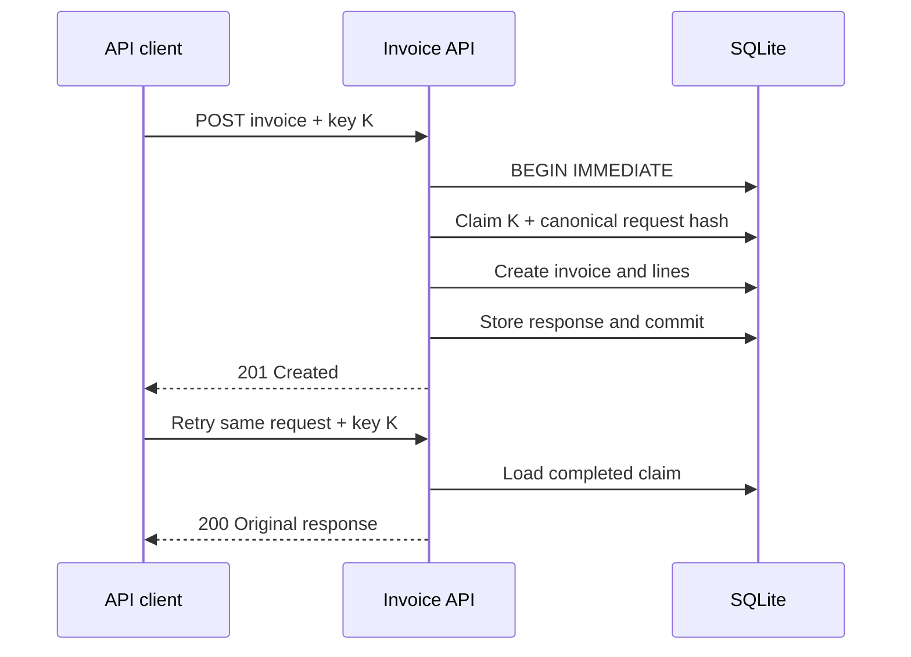

# Idempotent PHP API sample

A compact, production-oriented PHP example demonstrating scoped API keys,
transactional writes, organization isolation, and safe idempotent retries.

This repository extracts and generalizes patterns I use in private production
software. It contains no client code, credentials, production data, or private
Git history.

## The problem

A write can succeed even when its HTTP response is lost. If the caller retries
naively, it may create a duplicate invoice, order, or payment. This sample makes
the caller's intended operation explicit with an `Idempotency-Key` and stores
the result atomically with the resource it creates.



If the same key is reused with a different logical request, the API returns
`409 idempotency_conflict`. JSON formatting and object-key order do not affect
the request hash because validation produces a normalized request shape first.

## What it demonstrates

- Random API keys shown once and stored only as SHA-256 hashes
- Explicit `invoices:create` authorization scope
- Revocation and last-used tracking
- Strict Bearer-token and JSON request parsing
- Organization-scoped client, preset, key, and idempotency lookups
- One transaction for claim, resource creation, and saved response
- Database uniqueness as the final duplicate-write guard
- Deterministic replay after an uncertain network outcome
- PHPUnit coverage of authentication, replay, conflict, and tenant isolation

The domain is intentionally small. The point is the boundary behaviour around a
revenue-sensitive write, not a complete billing product.

## Requirements

- PHP 8.2 or newer
- Composer
- PDO SQLite

```bash
composer install
composer test
```

To exercise the minimal HTTP adapter:

```bash
php bin/setup.php
php -S 127.0.0.1:8080 -t public
```

The setup command prints a development API key once. Use it with the request
below, replacing `sample_...` with that value:

```bash
curl -i http://127.0.0.1:8080/invoices \
  -X POST \
  -H 'Authorization: Bearer sample_...' \
  -H 'Idempotency-Key: invoice:cli_example:2026-10' \
  -H 'Content-Type: application/json' \
  --data '{
    "client_public_id": "cli_example",
    "title": "October consulting",
    "lines": [{"preset_public_id": "pst_consulting", "quantity": 2}]
  }'
```

## API contract

```http
POST /invoices
Authorization: Bearer sample_...
Idempotency-Key: invoice:cli_example:2026-10
Content-Type: application/json
```

```json
{
  "client_public_id": "cli_example",
  "title": "October consulting",
  "lines": [
    {
      "preset_public_id": "pst_consulting",
      "quantity": 2
    }
  ]
}
```

First successful request:

```http
HTTP/1.1 201 Created
```

```json
{
  "invoice": {
    "id": 1,
    "status": "draft",
    "title": "October consulting",
    "total": "300.00"
  }
}
```

Retry with the same key and logical request:

```http
HTTP/1.1 200 OK
```

Reuse the key with different content:

```http
HTTP/1.1 409 Conflict
```

```json
{
  "error": {
    "code": "idempotency_conflict",
    "message": "This idempotency key was used for a different request."
  }
}
```

## Design notes

### Why the claim and write share a transaction

The idempotency record is not a cache added after the operation. Claiming the
key, creating the invoice, creating its lines, and saving the response are one
atomic unit. A failure rolls all of them back.

### Why normalized requests are hashed

Hashing raw JSON would treat whitespace or object-key ordering as a different
operation. `InvoiceRequest` validates the input and constructs a predictable
shape before hashing it.

### Why organization IDs appear in every lookup

Public IDs are identifiers, not authorization. Looking up a client or preset by
public ID alone would create a cross-organization data exposure risk. Every
query includes the active organization.

### SQLite and concurrency

The sample uses `BEGIN IMMEDIATE` so SQLite obtains its write reservation before
checking or inserting the idempotency record. The unique constraint on
`(organization_id, api_key_id, idempotency_key)` remains the authoritative
duplicate guard.

In MySQL or PostgreSQL, I would use the same logical boundary with the database's
native transaction and row-locking/upsert behaviour.

## Repository map

```text
src/Auth/            Bearer parsing, key creation and authentication
src/Database/        SQLite connection, migration and transaction boundary
src/Idempotency/     Claim and response persistence
src/Invoice/         Strict request model and transactional use case
src/Http/            Stable API error envelope
tests/               Behaviour-focused PHPUnit tests
schema.sql           Constraints and organization-scoped data model
public/index.php     Minimal HTTP adapter
bin/setup.php        Local database seed and one-time development key
```

## Scope and limitations

This is an educational code sample, not a drop-in billing service. A complete
deployment would also need host-to-organization resolution, rate limiting,
structured audit logging, secret rotation policy, observability, and an
operational strategy for abandoned `processing` claims.

## Author

[Luke Johnson](https://codigo.ca/) — full-stack developer and UX consultant.

Most of my production work is maintained in private commercial repositories.
This sample is published to demonstrate the engineering approach without
disclosing client systems or proprietary application code.
